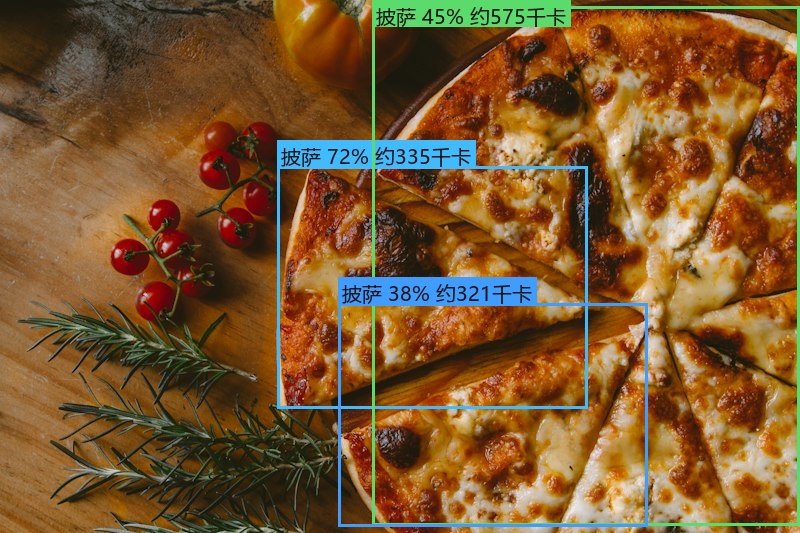
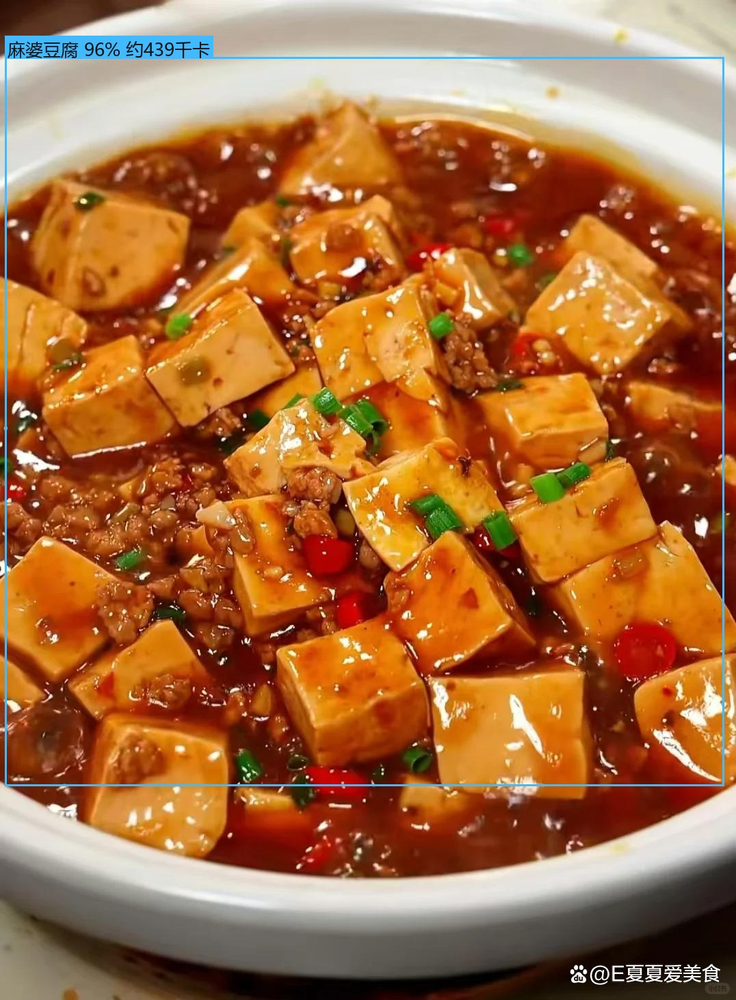

[English](README.md) | 中文

# 🍕 FoodCal — 拍照识别食物并估算卡路里

基于 **YOLOv8 目标检测 + 视觉大模型（GLM-4.6V）+ 营养数据库** 的「拍照算卡路里」项目，Streamlit 网页界面。


*YOLO 检测 + 中文标注 + 卡路里估算示例（3 块披萨，约 1231 千卡）*


*自训模型 food_v1 对验证集图片的识别：麻婆豆腐 96% · 约439千卡*

🌐 **在线试用**：[foodcal-yrnzc2mbennqpxvq6eqdfm.streamlit.app](https://foodcal-yrnzc2mbennqpxvq6eqdfm.streamlit.app/)（上传照片即可体验自训模型；GLM 引擎需在侧边栏填入自己的免费 Key）

## 📊 实验结果（v1 · 网图数据 · 20 类食堂菜）

训练配置：YOLOv8n @640，60 epochs，CPU（i7-14650HX）2.74 小时，数据 824 张（GLM 自动标注）。

| 指标 | 数值 |
|---|---|
| **mAP@50** | **0.863** |
| mAP@50-95 | 0.532 |
| Precision / Recall | 0.896 / 0.755 |
| 单张推理耗时（CPU） | 35.6 ms |

**表现最好的类**（AP@50 ≈ 0.99）：可乐鸡翅、宫保鸡丁、番茄炒蛋、炒面、糖醋里脊、蒸蛋羹、鱼香肉丝、青椒肉丝、酸辣土豆丝

**表现较差的类及归因**：
- 包子（0.478）：网图中包子/小笼包/生煎形态差异大，标注歧义高
- 米饭（recall 0.25）：白米饭在白瓷碗里对比度低，漏检多
- 饺子（0.165）/ 馒头：验证样本仅 2 张，统计不可靠 + 生熟形态混爬

**下一步（v2 改进方向）**：补实拍数据微调、对弱类定向补爬、类别均衡采样。

## 功能特性

- 📷 拍照 / 🖼️ 上传图片，自动检测画面中的食物并框出位置
- **三种识别引擎**，侧边栏一键切换：
  - 🔍 **本地 YOLO**：离线免费，速度快，类别取决于加载的权重
  - ☁️ **GLM 大模型**：整图识别，几乎能认任何菜（免费 API Key）
  - 🤝 **混合（推荐）**：YOLO 定位 + GLM 认菜名，精度与成本兼顾
- 内置 **87 种**食物营养数据库（20 种食堂菜 + 12 种甜点 + 12 种水果 + 14 种外国菜），未收录类别按 150 千卡/100克 兜底
- 份量粗估（检测框面积 / 大模型估计）+ 手动滑块微调
- 自动累加本餐 / 今日总热量，可下载标注图
- `build_dataset.py` 支持用 GLM **自动预标注**自建数据集

## 快速开始

```powershell
cd "D:\大学\AI\Food calories"
python -m venv .venv
.venv\Scripts\activate
pip install -r requirements.txt
streamlit run app.py
```

首次运行会自动下载 `yolov8n.pt`（约 6 MB）。浏览器打开 http://localhost:8501 即可使用。

**启用 GLM 引擎（可选，免费）**：到 [open.bigmodel.cn](https://open.bigmodel.cn) 注册并创建 API Key，复制 `.env.example` 为 `.env` 填入 `ZHIPU_API_KEY`（或在网页侧边栏直接粘贴）。`glm-4.6v-flash` 模型完全免费。

## 命令行方式

```powershell
python scripts/predict.py 某张图.jpg
python scripts/predict.py 某张图.jpg --weights models/food.pt --conf 0.3
```

## 识别更多食物：A 跑通 + C 做亮点

**C（亮点）**：GLM 引擎天然能认任何菜——GLM 取名时会自动参考营养库全表（在 `calories.csv` 加新菜即生效），已覆盖 20 种食堂菜、12 种甜点、12 种水果、14 种外国菜。填上免费 Key 即用。

**A（跑通自训模型）**：让本地 YOLO 也认识食堂菜，四步走：

**第 1 步：收集照片**（每道菜 20~50 张，正拍/侧拍/不同光线）

```
photos/
├── 番茄炒蛋/*.jpg
├── 宫保鸡丁/*.jpg
├── 米饭/*.jpg
└── ...（20 种食堂菜）
```

**第 2 步：自动预标注 + 构建数据集**

```powershell
python scripts/build_dataset.py --src photos --out data/datasets/food --auto-label
```

GLM 会给每张照片自动画出边界框并生成 YOLO 标签，按 85/15 切分 train/val，自动生成 `data.yaml`。

**第 3 步：人工抽查修正（关键，决定模型上限）**

下载 [X-AnyLabeling](https://github.com/CVHub520/X-AnyLabeling)，打开图片检查自动标注质量、修正错框漏框，把修正后的 `.txt` 放回照片旁，再跑一遍（不加 `--auto-label`）：

```powershell
python scripts/build_dataset.py --src photos --out data/datasets/food
python scripts/check_dataset.py data/datasets/food
```

**第 4 步：训练 + 评测 + 启用**

```powershell
python scripts/train.py --data data/datasets/food/data.yaml --epochs 60 --name food_v1
# 训练完把 runs/detect/food_v1*/weights/best.pt 复制到 models/food.pt

# 评测：mAP / 各类别 AP / 混淆矩阵（多个权重可做消融对比）
python scripts/evaluate.py detect --weights models/food.pt --data data/datasets/food/data.yaml
```

> v1 实测（纯网图数据，60 epochs）：**mAP@50 = 0.863**，9/20 类 AP@50 ≈ 0.99，详见上方「实验结果」。

刷新网页，侧边栏选择 `models/food.pt`，用 **混合引擎**：YOLO 框出每格菜 → GLM 确认菜名 → 查表算热量。这就是答辩演示的最佳形态。

## 量化评测（技术报告的数字来源）

`scripts/evaluate.py` 提供三组实验，结果输出到 `results/evaluation/`（CSV + JSON + 对比图）：

```powershell
# 1) 检测指标：mAP@50、mAP@50-95、各类别 AP、混淆矩阵；多个权重 = 消融实验
python scripts/evaluate.py detect --weights models/food.pt --data data/datasets/food/data.yaml
python scripts/evaluate.py detect --weights runs/auto/best.pt runs/corrected/best.pt --data ...

# 2) 热量估算误差：MAE / MAPE / ±20% 容差准确率（评测集：30~50 份真实餐盘）
python scripts/evaluate.py calories --set data/eval/calories_gt.csv --engine hybrid

# 3) 三引擎对比：top-1 准确率、延迟、API 调用次数（附对比图）
python scripts/evaluate.py engines --set data/eval/engines_gt.csv --engines yolo,glm,hybrid
```

评测集格式见 `data/eval/README.txt`。**自动标注消融**是最有报告价值的实验：同一批照片分别用纯自动标注 / 人工修正后标注训练，对比 mAP，即可量化"数据飞轮"中人工审核的价值。

## 卡路里估算原理

```
热量(千卡) = 份量(克) × 每100克热量 / 100
```

份量来源优先级：**大模型估计 > 检测框面积启发式 > 默认 150g**，网页里都可以用滑块手动修正。

面积启发式：假设检测框占画面 25% 时为「标准一份」，按 `sqrt(面积比 / 25%)` 缩放常见份量，限制在 0.5–2.5 倍。单张照片无法真正测距测体积，所以这只是粗估。

## 项目结构

```
Food calories/
├── app.py                    # Streamlit 网页（三引擎架构）
├── requirements.txt
├── .env.example              # API Key 配置模板
├── src/
│   ├── detector.py           # YOLO 检测封装
│   ├── vision.py             # GLM 视觉大模型（识别/认菜/自动标注）
│   ├── nutrition.py          # 营养数据库 + 份量/热量估算
│   └── visualize.py          # 中文标注框绘制（PIL）
├── scripts/
│   ├── train.py              # 训练自定义模型
│   ├── build_dataset.py      # 照片 → 自动预标注 → YOLO 数据集
│   ├── evaluate.py           # 量化评测（mAP / MAPE / 三引擎对比）
│   ├── check_dataset.py      # 数据集完整性检查
│   ├── predict.py            # 命令行预测
│   └── test_vision.py        # vision 模块离线测试
├── data/
│   ├── calories.csv          # 87 种食物营养数据库（可编辑，加条目即生效）
│   ├── eval/                 # 评测集（真实餐盘照片 + 真实值）
│   ├── samples/              # 测试图片
│   └── datasets/             # 训练数据集（不入库）
├── photos/                   # 自建数据集照片（按菜名分文件夹）
├── models/                   # 自定义模型权重（不入库）
└── results/                  # 识别结果输出
```

## 答辩可讲的点

1. **三引擎架构与成本权衡**：本地模型零成本离线 vs 大模型高精度按量付费 vs 混合取长补短
2. **数据飞轮**：用大模型给小模型做自动预标注，人工只做抽查修正，标注成本降低一个数量级
3. **诚实的局限性**：单目无法测体积，份量靠启发式 + 用户修正；营养值是平均值，实际因做法而异

## 免责声明

估算结果仅供参考，不能替代专业营养分析。
